University: [ITMO University](https://itmo.ru/ru/)
Faculty: [FICT](https://fict.itmo.ru)
Course: [Cloud platforms as the basis of technology entrepreneurship](https://github.com/itmo-ict-faculty/cloud-platforms-as-the-basis-of-technology-entrepreneurship)
Year: 2026/2027
Group: U4225
Author: Kaasamani Roni Bahaaevich
Lab: Lab2
Date of create: 06.11.2026
Date of finished: 06.11.2026

# Лабораторная работа №2. Исследование Cloud Run

## Цель работы

Ознакомиться с принципами работы Cloud Run.

## Ход работы

Проект: `cloud-platforms-as-the-basis`, регион `europe-west1`. Ресурсы создавались с префиксом `rkaasamani-`.

### 1. Создание сервиса

Создан сервис `rkaasamani-hello-lab2` из стандартного образа «Hello» (Cloud Run → Create service → Deploy one revision from an existing container image). Настройки: публичный доступ без аутентификации, биллинг по запросам (request-based), min instances = 0, max instances = 1, ресурсы 1 vCPU и 512 MiB.

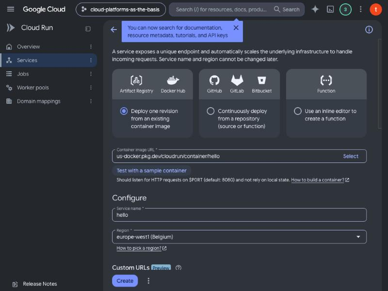

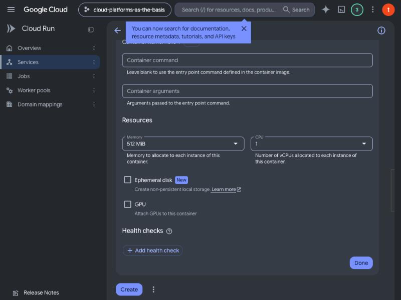

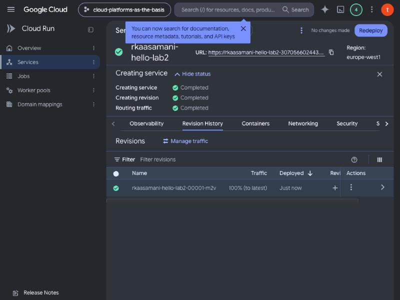

### 2. Проверка по URL

Сервис доступен по адресу `https://rkaasamani-hello-lab2-307056602443.europe-west1.run.app`. Страница «It's running!» сообщает, что создана ревизия `rkaasamani-hello-lab2-00001-m2v`.

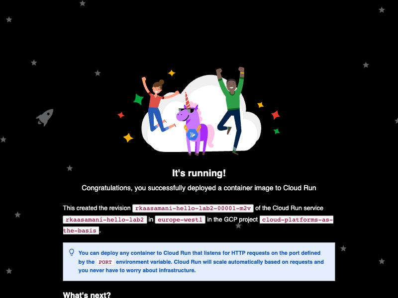

### 3. Логи и метрики

В логах видны создание ревизии (`Deploying revision succeeded in 3.01s`), успешная startup-проверка TCP-порта 8080 и запросы `GET 200` с задержкой 2–10 мс. Первый запрос после простоя поднимает новый инстанс (холодный старт), потому что min instances = 0.

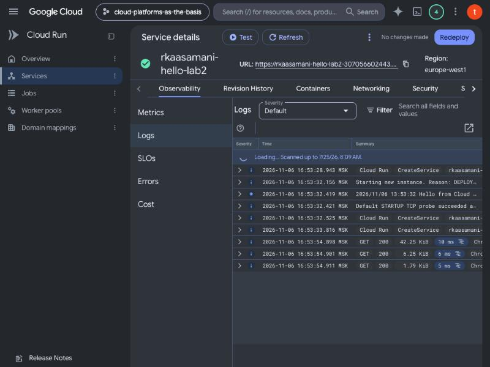

Метрики в консоли появляются с задержкой в несколько минут: сразу после запросов график был пуст («No data»), позже на нём появился всплеск Request count и задержки порядка единиц и десятков миллисекунд.

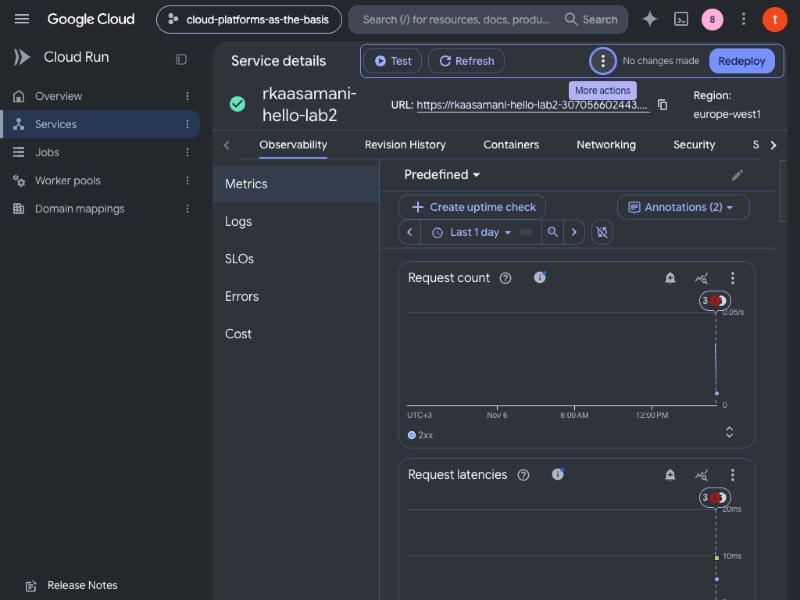

### 4. Смена порта на 8090

Через Edit & deploy new revision в настройках контейнера изменён Container port с 8080 на 8090.

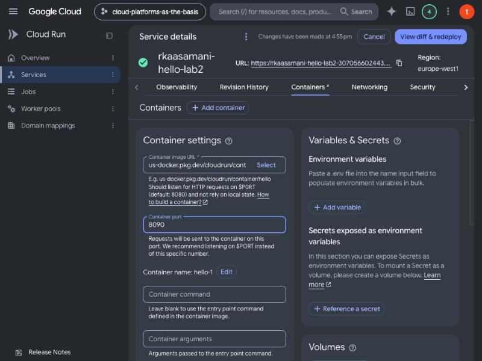

Ожидалось, что контейнер продолжит слушать 8080 и ревизия не пройдёт startup-проверку. На практике ревизия `rkaasamani-hello-lab2-00002-m9r` успешно запустилась (`succeeded in 3.4s`) и отвечает на запросы.

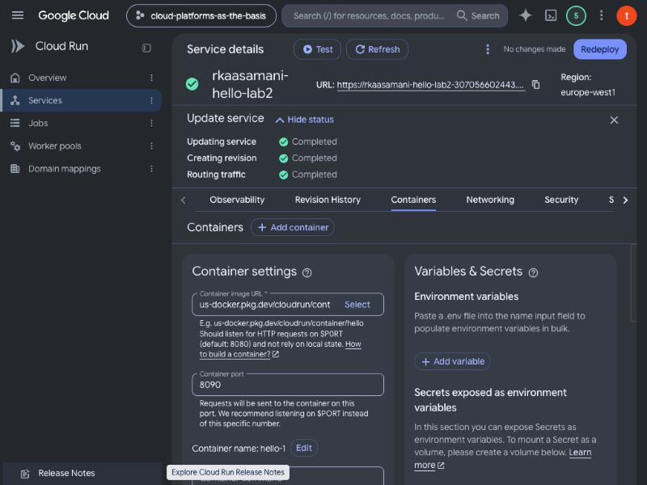

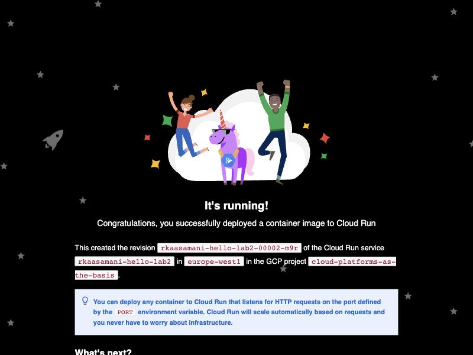

Причина видна в логах: контейнер пишет, что слушает HTTP-запросы на порту 8090, и startup-проверка проходит на 8090.

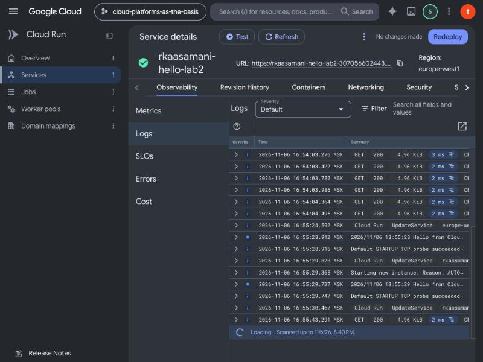

Cloud Run передаёт контейнеру переменную окружения `PORT`, равную указанному Container port, а образ hello читает `$PORT`, а не жёстко заданный 8080. Поэтому смена порта в настройках сервиса сработала сама по себе, без изменений в образе. Сломалось бы это для контейнера с жёстко прописанным портом, который игнорирует `PORT`.

### 5. Распределение трафика между ревизиями

После деплоя второй ревизии весь трафик шёл на неё (100% to latest). Попытка разделить трафик 50/50 в Revision History → Manage traffic завершилась ошибкой:

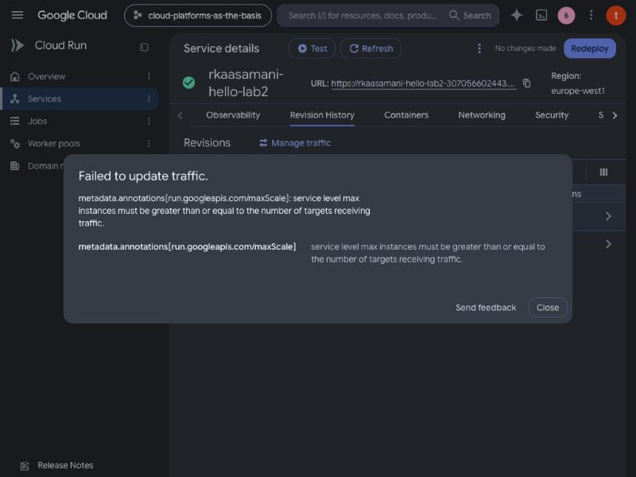

Текст ошибки: `service level max instances must be greater than or equal to the number of targets receiving traffic`. Максимум инстансов на уровне сервиса был равен 1, а для двух ревизий нужно минимум 2. Исправление: на вкладке Scaling max instances изменён с 1 на 2 (изменение уровня сервиса, новая ревизия не создаётся).

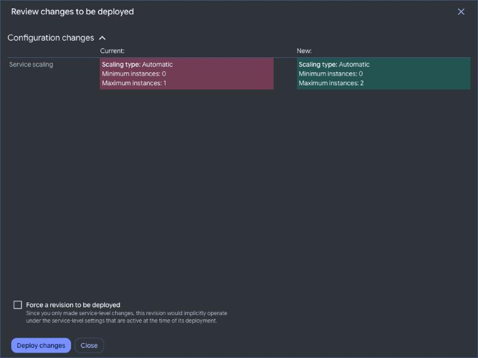

После этого разделение 50/50 между ревизиями `00001-m2v` и `00002-m9r` сохранено успешно.

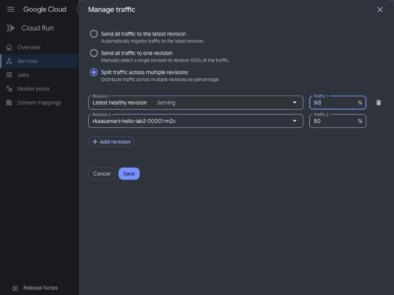

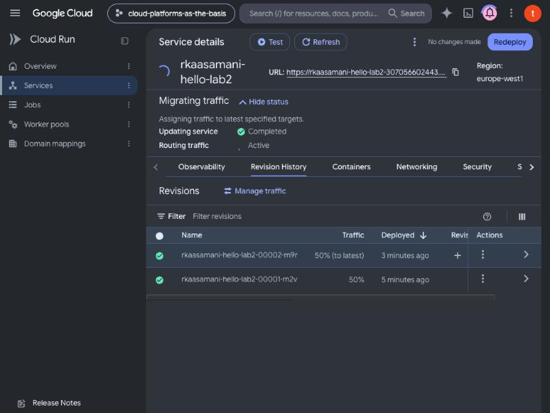

Проверка: при повторных запросах к одному и тому же URL (`?r=1`, `?r=2`, …) страница называет разные ревизии. Из 12 запросов часть ответила ревизия `00001-m2v`, часть `00002-m9r`; выбор ревизии случайный, поэтому точной пропорции 6/6 на малой выборке нет.

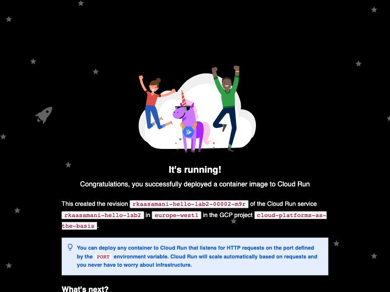

### 6. Удаление ресурсов

Сервис `rkaasamani-hello-lab2` удалён (подтверждение вводом имени). Консоль показала уведомление «Service rkaasamani-hello-lab2 deleted».

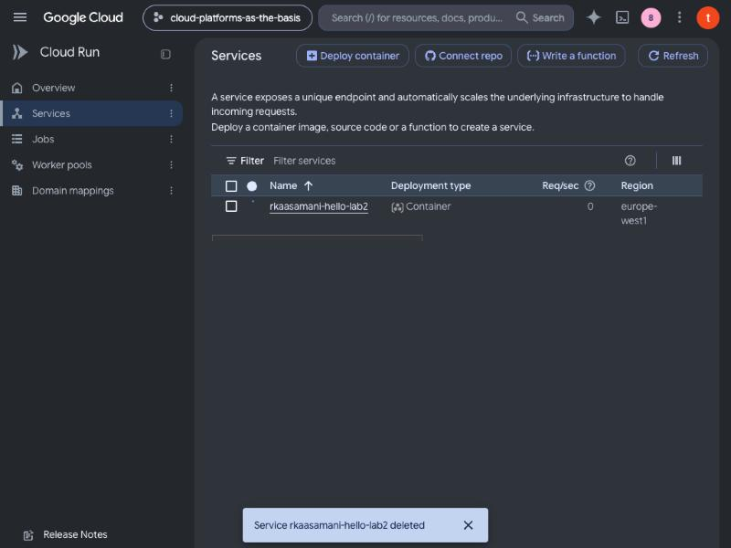

## Выводы

- Cloud Run запускает контейнер по HTTP-запросам и масштабирует число инстансов, в том числе до нуля при min instances = 0. Платить приходится только за обработку запросов (request-based биллинг), цена за это — холодный старт после простоя.
- Каждое изменение конфигурации контейнера создаёт новую ревизию; прежние ревизии остаются и могут получать трафик.
- Порт контейнера задаётся переменной `PORT`, которую подставляет Cloud Run. Приложение должно слушать именно `$PORT`; образ hello так и делает, поэтому смена порта на 8090 прошла без ошибок.
- Для разделения трафика между N ревизиями максимум инстансов сервиса должен быть не меньше N. Разделение трафика (50/50, 80/20) позволяет раскатывать новую версию постепенно (canary) и быстро откатываться.
- Метрики в консоли отстают от реального времени, логи доступны сразу.
