University: [ITMO University](https://itmo.ru/ru/)
Faculty: [FICT](https://fict.itmo.ru)
Course: [Cloud platforms as the basis of technology entrepreneurship](https://github.com/itmo-ict-faculty/cloud-platforms-as-the-basis-of-technology-entrepreneurship)
Year: 2026/2027
Group: U4225
Author: Kaasamani Roni Bahaaevich
Lab: Lab3
Date of create: 06.11.2026
Date of finished: 06.11.2026

# Лабораторная работа №3. Исследование Cloud Storage

## Цель работы

Ознакомиться с основными понятиями и принципами работы облачного хранилища: блочное, файловое и объектное хранение, сервисы и функции облачных хранилищ.

## Теоретическая часть

| Тип хранения | Единица данных | Доступ | Пример в Google Cloud | Типичное применение |
|--------------|----------------|--------|-----------------------|---------------------|
| Блочное | блок фиксированного размера | как к диску, через ОС виртуальной машины | Persistent Disk, Hyperdisk | системные диски ВМ, базы данных |
| Файловое | файлы в дереве каталогов | по сетевому протоколу (NFS/SMB), общий доступ нескольких клиентов | Filestore | общие папки, приложения с общей файловой системой |
| Объектное | объект (данные + метаданные + имя) в плоском пространстве имён | HTTP/API по имени объекта | Cloud Storage | изображения, видео, бэкапы, статические сайты, данные для ML |

В Cloud Storage объекты лежат в бакетах. Папок как таковых нет: пространство имён плоское, а «папка» это префикс в имени объекта (консоль показывает его как каталог). Класс хранения определяет цену хранения и доступа:

| Класс | Для чего | Минимальный срок хранения |
|-------|----------|--------------------------|
| Standard | часто используемые данные | нет |
| Nearline | доступ реже раза в месяц | 30 дней |
| Coldline | доступ реже раза в квартал | 90 дней |
| Archive | доступ реже раза в год | 365 дней |

## Ход работы

Проект: `cloud-platforms-as-the-basis`. Бакет с префиксом `rkaasamani-`.

### 1. Создание бакета

Создан бакет `rkaasamani-lab3-bucket-2026`: регион `europe-west1` (Belgium), класс хранения Standard. Имя бакета глобально уникально, поэтому в нём есть логин. Регион выбран один (а не multi-region), потому что он дешевле, а для учебной работы высокая доступность между континентами не нужна.

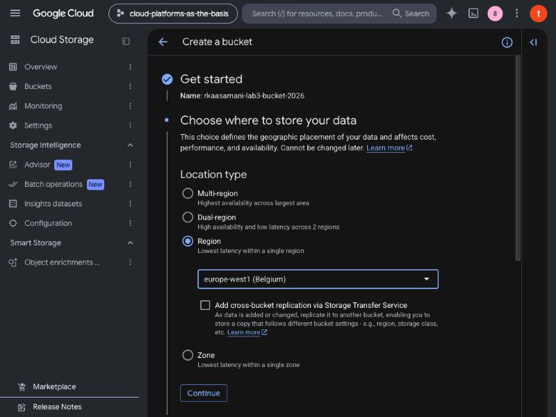

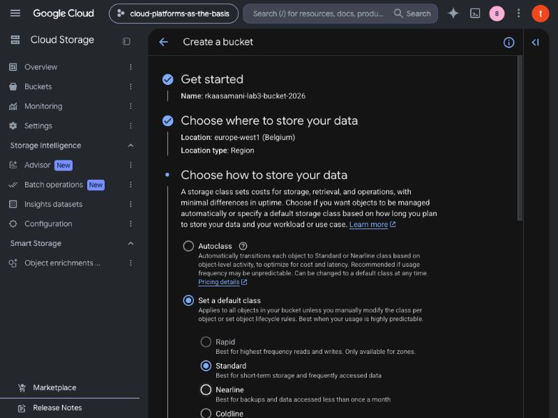

По умолчанию включено «Enforce public access prevention», оно запрещает любой публичный доступ. Для задания флажок снят.

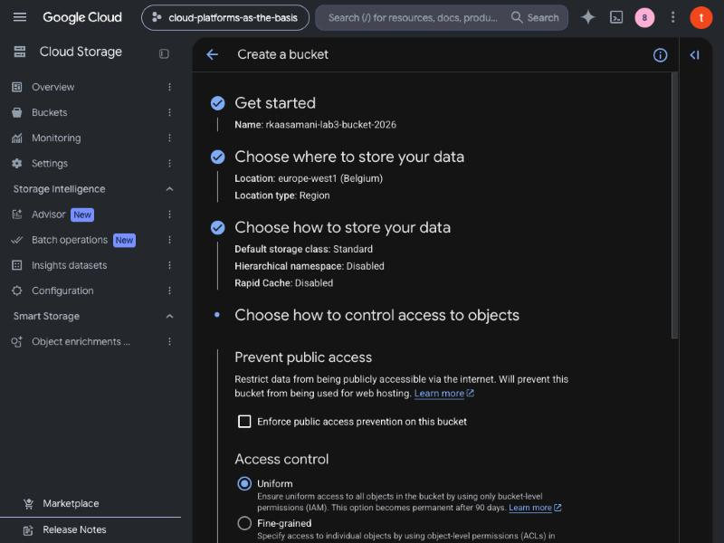

Контроль доступа оставлен «Uniform» (права задаются только через IAM на уровне бакета, без ACL на отдельных объектах).

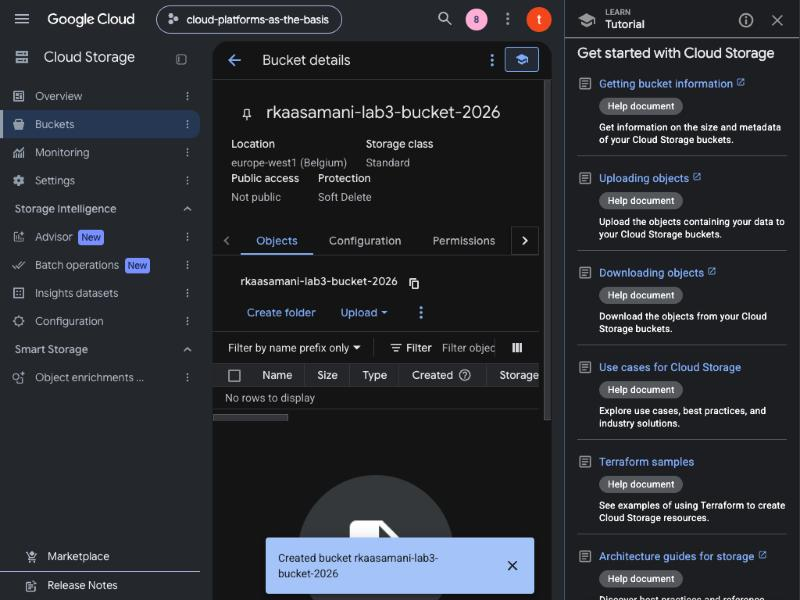

### 2. Загрузка файлов

Загружено 2 изображения (JPEG): `images (1).jpeg` (40,3 КБ) и файл с хеш-именем (102,8 КБ). Загрузка выполнена через кнопку Upload в консоли вручную владельцем аккаунта: диалог выбора файлов недоступен автоматизации браузера. Попытка загрузить файлы через Cloud Shell не удалась, потому что окно авторизации Cloud Shell открывается во всплывающем окне, а всплывающие окна в автоматизируемом браузере блокируются; gcloud остался без активной учётной записи.

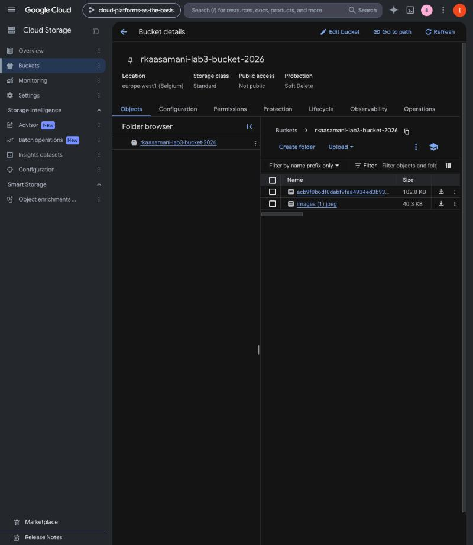

### 3. Папка и перемещение файлов

Через Create folder создана папка `photos/`. В консоли у нескольких выделенных объектов нет действия Move (доступны только Download и Delete), поэтому каждый файл перенесён через меню ⋮ → Move с указанием назначения `rkaasamani-lab3-bucket-2026/photos/`. Папка при этом осталась на месте, а файлы изменили полное имя: теперь это `photos/images (1).jpeg` и т.д.

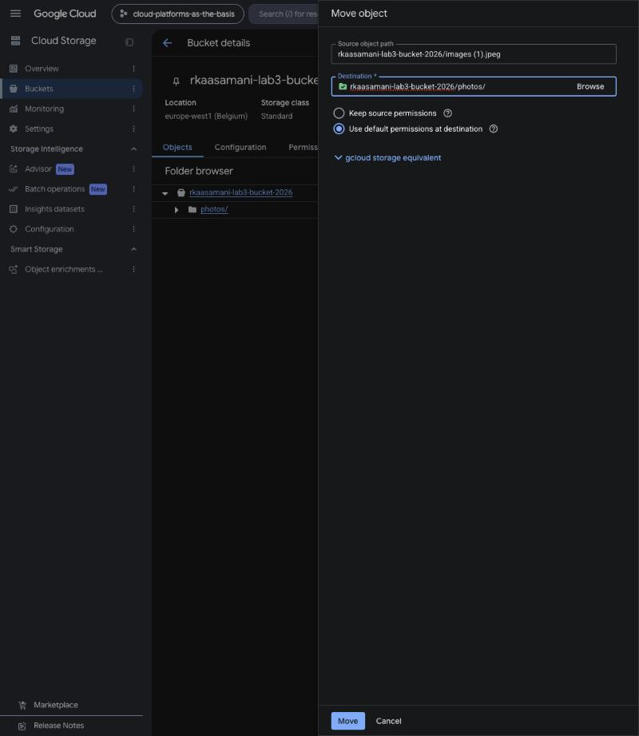

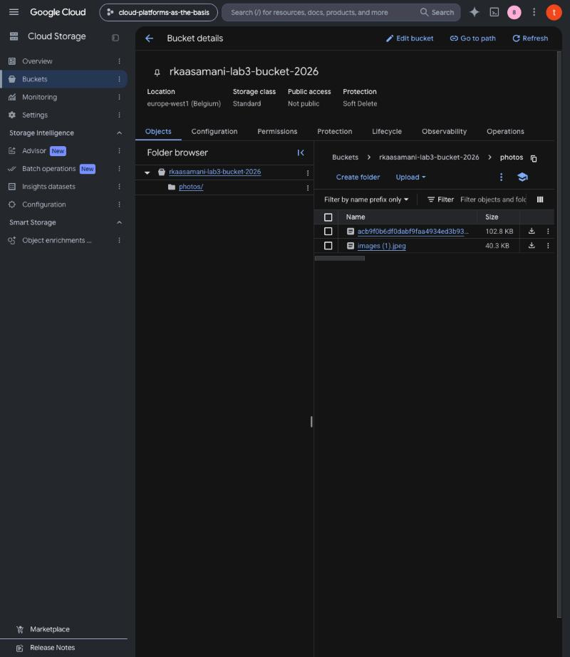

### 4. Публичный доступ

На вкладке Permissions → Grant access добавлен principal `allUsers` с ролью `Storage Object Viewer` (просмотр объектов без права записи). Консоль предупреждает, что бакет станет публичным для всего интернета, и просит подтверждения (Allow Public Access).

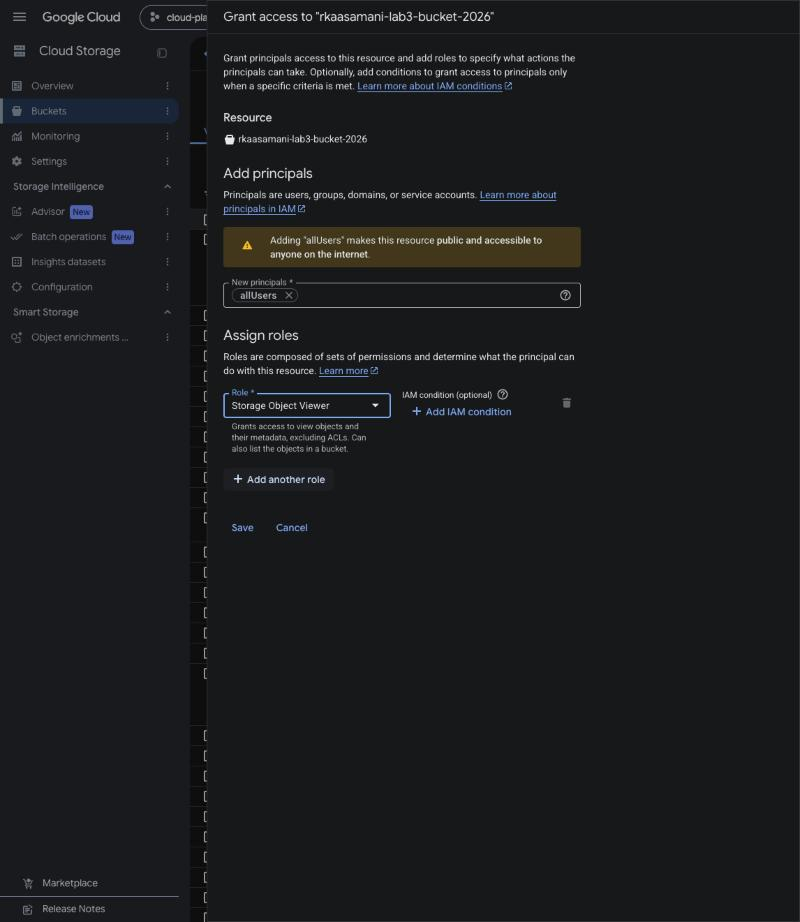

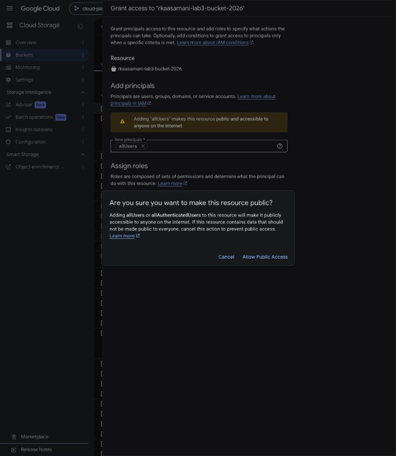

После этого у бакета показывается «Access granted to public principals».

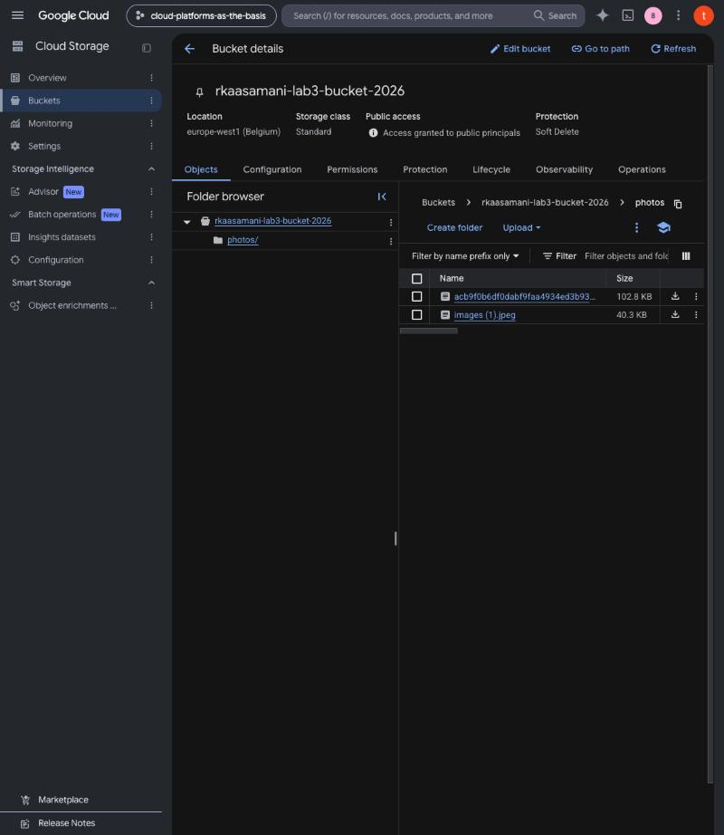

Поле Public access было бы «Not public» без этого шага: на предыдущих скриншотах оно именно такое.

### 5. Публичная ссылка

На странице объекта показаны три адреса: Public URL, Authenticated URL и Cloud Storage URI. Публичная ссылка имеет вид `https://storage.googleapis.com/<бакет>/<объект>`, т.е. `https://storage.googleapis.com/rkaasamani-lab3-bucket-2026/photos/images%20(1).jpeg`. Authenticated URL (`storage.cloud.google.com`) требует входа в аккаунт Google, а `gs://` используется утилитами gcloud.

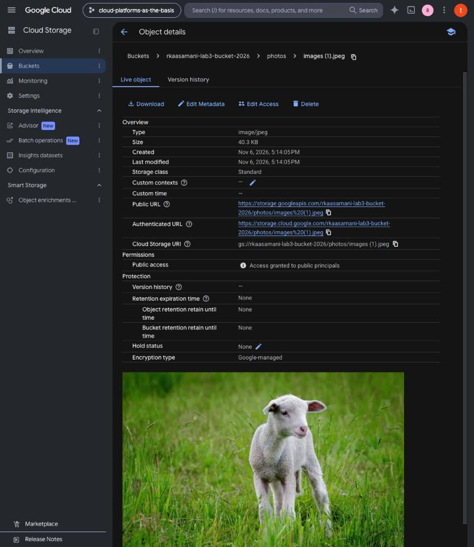

Ссылка открыта в браузере и показывает изображение.

Замечание о проверке: режим инкогнито в используемом браузере недоступен, поэтому ссылка открыта в обычном окне. Это не искажает результат: домен `storage.googleapis.com` не использует куки аккаунта Google, и файл отдаётся только потому, что роль выдана `allUsers`. Проверить ссылку без прав из консоли в этом окружении не получилось: запрос из песочницы (curl) блокируется её сетевым фильтром, поэтому на скриншоте нет ответа HTTP от «чистого» клиента.

### 6. Удаление ресурсов

Бакет `rkaasamani-lab3-bucket-2026` удалён (подтверждение вводом слова DELETE). Консоль сообщила «Deleting 1 bucket». Удаление «мягкое» (soft delete): данные хранятся 7 дней и затем удаляются навсегда, при этом публичный доступ к ним прекращается. Чужие бакеты проекта не затрагивались.

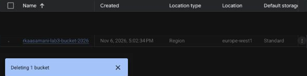

## Выводы

- Cloud Storage относится к объектному хранению: данные адресуются по имени объекта через HTTP, а «папки» это лишь префиксы имён.
- Бакет по умолчанию закрыт (public access prevention включён). Для публичной раздачи нужно сознательно выключить запрет и выдать `allUsers` роль `Storage Object Viewer`. Выдача роли на весь бакет открывает все объекты, включая те, что будут загружены позже, поэтому для приватных данных так делать нельзя.
- При включённом Uniform bucket-level access права задаются одной политикой IAM на бакет, а не на каждый файл.
- Класс хранения выбирают по частоте доступа: Standard для часто читаемых данных, Nearline/Coldline/Archive для всё более редких и более дешёвых по хранению.
- Публичный бакет не нужно оставлять после работы: ресурсы удалены.
