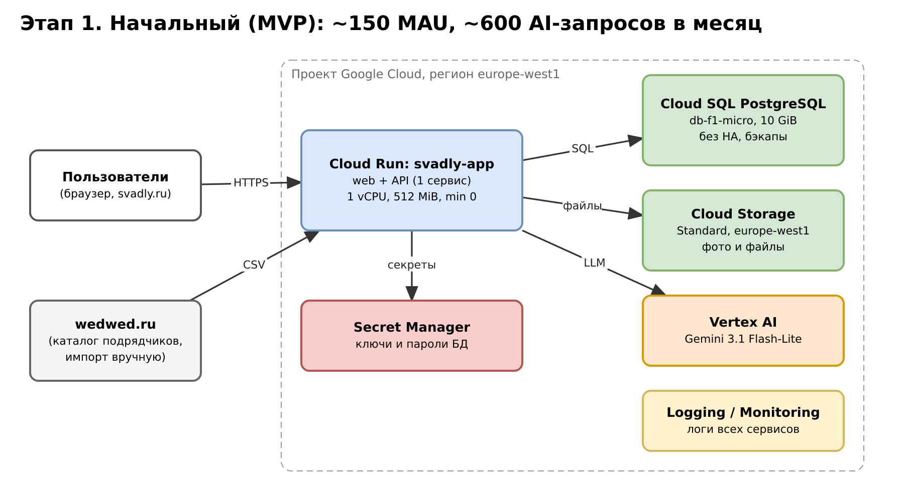
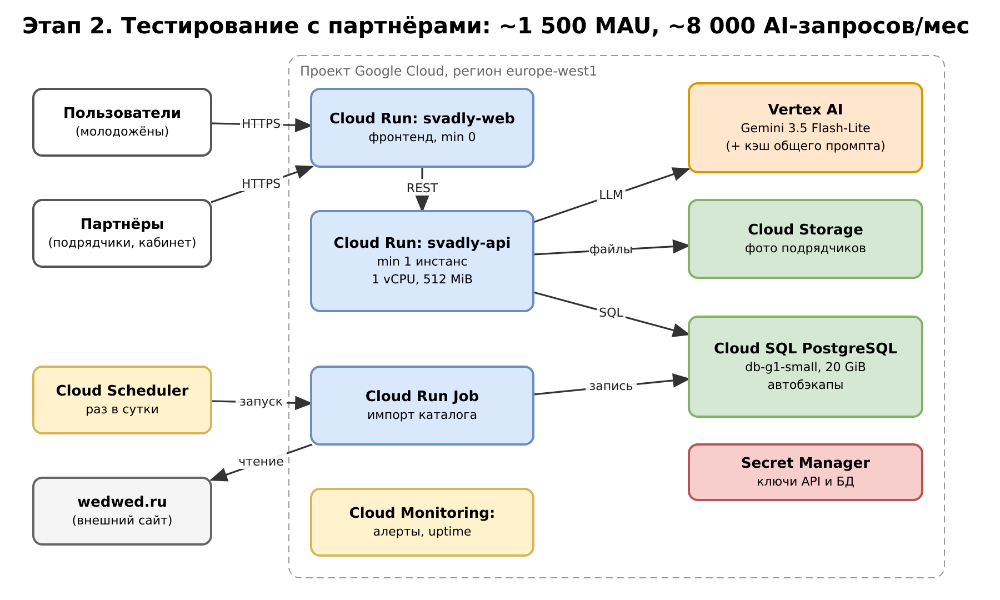
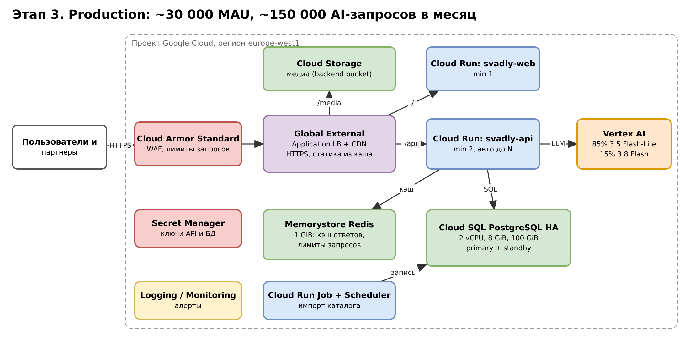

University: [ITMO University](https://itmo.ru/ru/)
Faculty: [FICT](https://fict.itmo.ru)
Course: [Cloud platforms as the basis of technology entrepreneurship](https://github.com/itmo-ict-faculty/cloud-platforms-as-the-basis-of-technology-entrepreneurship)
Year: 2026/2027
Group: U4225
Author: Kaasamani Roni Bahaaevich
Lab: Lab4
Date of create: 06.11.2026
Date of finished: 06.11.2026

# Лабораторная работа №4. Разработка инфраструктуры MVP AI-приложения

## Цель работы

Спроектировать инфраструктуру прототипа AI-приложения с базовой функциональностью и оценить стоимость её эксплуатации на трёх этапах развития.

## 1. Описание приложения и исходные данные

**Приложение: Svadly** (svadly.ru) — командный проект. AI-сервис, который помогает паре рассчитать бюджет свадьбы: пользователь описывает формат праздника (число гостей, город, пожелания), модель Gemini составляет разбивку бюджета по категориям и подбирает подрядчиков (площадки, фотографы, ведущие и т. д.) из каталога. Каталог подрядчиков импортируется с сайта wedwed.ru.

**Что хранится и обрабатывается:**
- пользователи, сценарии бюджета, каталог подрядчиков — реляционные данные (PostgreSQL);
- фото подрядчиков и файлы — объектное хранилище;
- запросы к LLM (≈2 000 входных и ≈1 000 выходных токенов на запрос).

**Важно:** реальных измерений нагрузки у проекта пока нет. Все цифры по нагрузке ниже — **предположения автора** для расчёта. Они вынесены на лист `Assumptions` файла `economic_model.xlsx` (синие ячейки), поэтому их можно изменить, и стоимость пересчитается.

## 2. Три этапа развёртывания

| Этап | Нагрузка | Требования |
|------|----------|-----------|
| 1. Начальный (MVP) | ≈150 MAU, ≈30 тыс. HTTP-запросов, ≈600 AI-запросов в месяц | минимальная цена, один сервис, масштабирование до нуля, ручной импорт каталога; допустим холодный старт |
| 2. Тестирование с партнёрами | ≈1 500 MAU, ≈400 тыс. HTTP-запросов, ≈8 000 AI-запросов в месяц | без холодного старта, отдельный кабинет подрядчиков, автоматический импорт каталога, мониторинг, бэкапы |
| 3. Production | ≈30 000 MAU, ≈8 млн HTTP-запросов, ≈150 000 AI-запросов в месяц | отказоустойчивая БД, защита от атак и всплесков, кэш, раздача статики через CDN, контроль стоимости AI |

## 3. Схема инфраструктуры (draw.io)

Схемы редактируются в draw.io (файлы `.drawio`), рядом лежат экспорты `.svg` и `.png`.

**Этап 1.** [stage1.drawio](diagrams/stage1.drawio), [svg](diagrams/stage1.svg)

**Этап 2.** [stage2.drawio](diagrams/stage2.drawio), [svg](diagrams/stage2.svg)

**Этап 3.** [stage3.drawio](diagrams/stage3.drawio), [svg](diagrams/stage3.svg)

## 4. Обоснование выбора ресурсов

**Cloud Run (вычисления).** Платим только за время обработки запросов, при нуле запросов инстансов нет. Это подходит этапу 1 с редкими визитами. Альтернативы: Compute Engine (платим за ВМ круглосуточно, нужно администрировать), GKE (избыточно для одного приложения). На этапе 2 включаем минимум 1 инстанс, чтобы пользователь не ждал холодный старт, и делим приложение на web и API. На этапе 3 — min 1 для web и min 2 для API, автомасштабирование. Импорт каталога вынесен в Cloud Run Job по расписанию Cloud Scheduler, чтобы не нагружать API.

**Cloud SQL for PostgreSQL (база данных).** Данные связные (пользователи, сценарии, подрядчики), нужны транзакции и SQL. Этап 1: db-f1-micro без HA, 10 GiB — самый дешёвый вариант. Этап 2: db-g1-small, 20 GiB и автоматические бэкапы, так как f1-micro слишком слаб для партнёров. Этап 3: HA-конфигурация (primary + standby) на 2 vCPU / 8 GiB, 100 GiB SSD — падение одной зоны не должно останавливать продукт. Это самая дорогая статья после AI. Альтернатива — Firestore (дешевле на малой нагрузке, но сложнее для отчётных запросов по каталогу).

**Cloud Storage (файлы).** Фото подрядчиков и загрузки пользователей. Класс Standard в том же регионе: дёшево (≈$0.02 за GiB в месяц) и нет платы за извлечение. Хранить файлы в БД дороже и медленнее. На этапе 3 бакет подключается как backend bucket за Load Balancer, чтобы медиа отдавались через CDN.

**Vertex AI (модели Gemini).** На этапе 1 берём Gemini 3.1 Flash-Lite — самую дешёвую модель, качества достаточно для первых сценариев. На этапе 2 переходим на 3.5 Flash-Lite и включаем контекстное кэширование общего системного промпта (кэшированные токены дешевле). На этапе 3 вводим маршрутизацию: ≈85% запросов на 3.5 Flash-Lite, ≈15% сложных на 3.8 Flash. Альтернатива — своя модель на GPU (дорого и сложно при такой нагрузке) или сторонний API (вне Google Cloud, отдельный биллинг).

**Secret Manager.** Ключи и пароли БД не хранятся в коде или переменных образа. Стоит копейки, нужен с первого этапа.

**Cloud Logging / Monitoring.** Этап 1 — стандартные логи. Этап 2 — алерты и uptime-проверки (критично при партнёрах). Этап 3 — алерты по ошибкам, задержке и бюджету.

**Global External Application Load Balancer + Cloud CDN + Cloud Armor (только этап 3).** Дают единую точку входа, кэширование статики и медиа (в расчёте принят hit-ratio 80%, это допущение) и фильтрацию вредного трафика. На малой нагрузке они не окупаются: только балансировщик стоит около $30 в месяц, поэтому на этапах 1–2 используется встроенный домен Cloud Run.

**Memorystore Redis, 1 GiB (только этап 3).** Кэш ответов и счётчики лимитов запросов. Снижает число обращений к БД и повторных вызовов модели. Basic-уровень без реплики достаточен для кэша, потерять его не страшно.

## 5. Экономическая модель

Расчёт — в файле [economic_model.xlsx](economic_model.xlsx) (листы `Prices`, `Assumptions`, `Cost`; цены и допущения в отдельных ячейках, итоги считаются формулами).

| Статья расходов | Этап 1, $/мес | Этап 2, $/мес | Этап 3, $/мес |
|---|---:|---:|---:|
| Cloud Run | 0.00 (укладывается в free tier) | 9.86 | 52.56 |
| Cloud SQL | 10.17 | 30.55 | 244.36 |
| Cloud Storage | 0.07 | 0.65 | 10.50 |
| Сеть (egress, LB, CDN, Armor) | 0.60 | 6.00 | 185.45 |
| Memorystore Redis | — | — | 35.77 |
| AI (Vertex AI Gemini) | 1.20 | 23.50 | 667.80 |
| Прочее (логи и т. п.) | 3.10 | 10.20 | 40.50 |
| **Итого в месяц** | **15.13** | **80.76** | **1 236.94** |
| Итого в год | 181.56 | 969.11 | 14 843.23 |

Удельные показатели:

| Показатель | Этап 1 | Этап 2 | Этап 3 |
|---|---:|---:|---:|
| Стоимость одного AI-запроса, $ | 0.0020 | 0.0029 | 0.0045 |
| Стоимость на одного MAU в месяц, $ | 0.101 | 0.054 | 0.041 |
| Доля AI в расходах | 7.9% | 29.1% | 54.0% |

**Источники цен:** официальные страницы тарифов Google Cloud (Cloud Run, Cloud SQL, Cloud Storage, Vertex AI, Cloud Load Balancing, Cloud CDN, Cloud Armor, Memorystore), открытые 06.11.2026. Все значения с единицами лежат на листе `Prices`.

**Ограничения расчёта (честно):**
- Нагрузка — допущения автора, не измерения.
- Часть цен взята из прайса для us-central1; для europe-west1 значения могут немного отличаться, их нужно сверить в Google Cloud Pricing Calculator.
- Цена Artifact Registry ($0.10 за GiB) и статья «Прочее» — оценка автора, не прайс.
- Для Gemini 3.8 Flash принята стандартная цена, которая действует с 01.01.2027; до 31.12.2026 действует вводная цена ниже, поэтому в первые недели Production было бы дешевле.
- НДС, налоги и скидки за обязательства (CUD) не учитывались.

## Выводы

1. Один и тот же продукт стоит около $15, $81 и $1 237 в месяц на трёх этапах: стоимость растёт быстрее, чем нагрузка по MAU в ощутимой части за счёт AI, баз данных и сетевой защиты, но **цена на пользователя падает** (с $0.10 до $0.04).
2. Самая большая статья на этапе 3 — токены AI (54%). Поэтому главные рычаги экономии здесь: дешёвая модель по умолчанию, маршрутизация только сложных запросов на более дорогую модель, контекстное кэширование промпта и кэш ответов в Redis.
3. Самый дешёвый вариант этапа 1 нельзя просто «растянуть»: db-f1-micro не подходит для партнёров, поэтому на этапе 2 меняется класс БД, а на этапе 3 добавляется HA — скачок стоимости БД с $10 до $244 осознанный, он покупает отказоустойчивость.
4. Load Balancer, CDN и Cloud Armor дают смысл только при большом трафике и атаках; на малых этапах они бы увеличили счёт без пользы (балансировщик один стоит около $30 в месяц).
5. Cloud Run с масштабированием до нуля делает этап 1 практически бесплатным по вычислениям; на этапе 2 минимум 1 инстанс — небольшая плата за отсутствие холодного старта.
6. Расчёт нужно уточнять по реальным метрикам, как только они появятся: главная неопределённость — число AI-запросов на пользователя и размер промпта.
